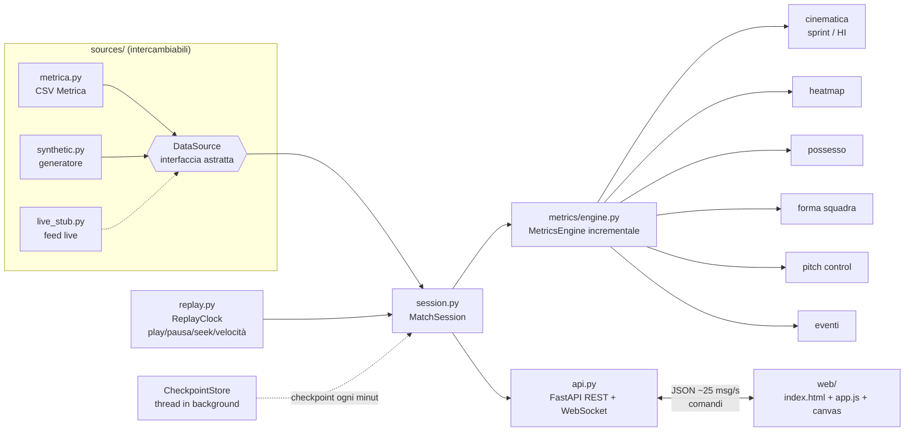

# Live Match Tracking

**Una partita di calcio vera, riprodotta come se fosse in diretta.**
I 22 giocatori (pallini con numero di maglia) e la palla si muovono su un campo visto dall'alto, mentre possesso,
distanze, velocità, sprint, forma di squadra, pitch control e heatmap si aggiornano in tempo reale.


| Pitch control | Heatmap del giocatore | Mobile (390 px) |
|---|---|---|
|  |  |  |

*Metrica Sample Game 1. In alto: 13 s di replay a 2× fino al gol del 2–0 (57:30). Media generata con `scripts/make_demo.js`.*

L'architettura è quella di un sistema live reale: la sorgente dati è un'interfaccia astratta (`DataSource`), e un feed
in diretta vero si collega scrivendo un solo adattatore, senza toccare replay, metriche, API o frontend.
Non è un progetto di computer vision: si lavora su **tracking data già pronti** (posizioni x, y di giocatori e palla a 25 Hz)
dei dati pubblici [Metrica Sports](https://github.com/metrica-sports/sample-data).

## Cosa fa

- **Replay "live"** a 0.5×, 1×, 2×, 5×, 10× con pausa, ripresa e seek su un punto qualsiasi della partita (click sulla timeline).
- **WebSocket a 25 messaggi/s** con posizioni compatte; il browser interpola tra gli snapshot a 60 fps.
- **Motore di statistiche incrementale**: ogni frame aggiorna lo stato delle metriche, nulla viene ricalcolato da zero.
- **Pannello live**: barre possesso e pitch control, KPI di squadra (tiri, passaggi, distanza, sprint, alta intensità,
  larghezza, lunghezza, linea difensiva, falli, velocità palla), tabella giocatori ordinabile, heatmap del giocatore
  selezionato (click sul pallino o sulla riga), feed eventi, banner al gol, timeline con tiri/gol/cartellini.
- **Overlay sul campo**: pitch control (rosso/azzurro), inviluppo convesso di ogni squadra con baricentro e linea difensiva,
  scia della palla, anello sul giocatore in possesso.
- 4 partite disponibili: Metrica Game 1 e Game 2 complete (se scaricate), un campione di 2 minuti incluso nel repo
  e una partita sintetica generata.

## Avvio rapido

Requisiti: Python ≥ 3.11 e `git`.

```bash
git clone https://github.com/Lupo433/live-match-tracking.git
```

```bash
cd live-match-tracking
```

```bash
python -m venv .venv && source .venv/bin/activate
```

```bash
pip install -e ".[dev]"
```

```bash
python scripts/download_data.py
```

```bash
python -m livematch
```

Poi apri **http://127.0.0.1:8000** nel browser (oppure con Docker: vedi [`docs/deploy.md`](docs/deploy.md)). Il download (≈230 MB) è facoltativo: senza, l'app funziona con il campione
di 2 minuti incluso (`data/sample/`) e con la partita sintetica. Opzioni: `python -m livematch --host 0.0.0.0 --port 8080`.
Una partita specifica si apre con `http://127.0.0.1:8000/?match=metrica_game_2`.

Comandi da tastiera: **spazio** = play/pausa. Click sulla timeline = seek. Click su un giocatore = heatmap.

### Test e lint

```bash
python -m pytest
```

```bash
ruff check . && ruff format --check .
```

I test (57) coprono loader e conversione coordinate, replay (timing, velocità, seek), ogni metrica con casi dal risultato
noto, sessione (nessun frame perso a 10×, seek coerente), API REST e WebSocket, adattatore live ed end-to-end sul campione.
La CI GitHub Actions (`.github/workflows/ci.yml`) esegue ruff e pytest a ogni push.

## Architettura



```
src/livematch/
├── schema.py            # modello dati unico: Player, Frame, Event, MatchInfo (metri, campo 105x68)
├── catalog.py           # partite disponibili, caricamento lazy con cache
├── replay.py            # ReplayClock: tempo reale -> frame (orologio iniettabile per i test)
├── session.py           # MatchSession (una per client) + CheckpointStore condiviso
├── api.py               # FastAPI: REST + WebSocket /ws
├── __main__.py          # python -m livematch [--live-demo]
├── cache.py             # cache su disco (.cache/): CSV convertiti e checkpoint
├── goals.py             # frame del gol al passaggio della linea
├── report.py            # report post-partita HTML (python -m livematch.report)
├── analytics/           # geometry, xt, xg, passes, models(.json): modelli dimostrativi
├── engagement/          # schema, align, analysis (event study), synthetic, marketing
├── live/                # provider.py (fake provider), demo.py (--live-demo)
├── sources/
│   ├── base.py          # DataSource (ABC): info, players, events, frame(i), frames()
│   ├── array_source.py  # implementazione in memoria su array numpy
│   ├── metrica.py       # loader CSV Metrica -> schema interno
│   ├── synthetic.py     # partita sintetica plausibile (fallback e test)
│   └── live_stub.py     # LiveFeedSource + JitterBuffer + ProviderFeedSource (adattatore live)
├── metrics/
│   ├── engine.py        # compone tutte le metriche, snapshot JSON, checkpoint/restore
│   ├── kinematics.py    # distanza, velocità Savitzky-Golay, sprint, alta intensità
│   ├── heatmap.py  possession.py  shape.py  pitch_control.py  events.py
│   ├── threat.py        # xT / xG live
│   └── excitement.py    # excitement index per secondo
└── web/                 # una pagina statica: HTML + JS vanilla + canvas, nessun build step
```

**Flusso di un tick (ogni 40 ms, per client):** il `ReplayClock` dice a che frame siamo (`posizione = ancora + Δt·fps·velocità`);
la sessione passa al motore di metriche *tutti* i frame dall'ultimo consumato a quello corrente (a 10× sono 10 frame), con un
budget di tempo per non bloccare mai il WebSocket; poi invia un solo snapshot con le posizioni (e ogni 5 tick le statistiche).
Così ad alta velocità non si perdono frame nelle metriche e la banda resta costante.

**Seek istantaneo:** alla prima apertura di una partita un thread in background la processa per intero una volta
(~35 s per 90 minuti) e salva un checkpoint dello stato delle metriche ogni minuto, condiviso tra tutti i client.
Un seek riparte dal checkpoint più vicino e riprocessa al massimo un minuto di frame. Prima che i checkpoint siano pronti,
il badge "Sincronizzo statistiche…" mostra l'avanzamento del recupero.

### Protocollo WebSocket (`/ws?match_id=...&autoplay=1`)

Server → client:

| `type` | Contenuto |
|---|---|
| `init` | metadata partita, roster (`i, id, team, num, name, gk`), tutti gli eventi (con `gf` = frame del gol sulla linea), partite disponibili, velocità ammesse, `live` |
| `frame` | `f` frame, `n` frame disponibili, `t` secondi, `per` periodo, `clk` orologio "57:29", `pl` posizioni `[x0,y0,x1,y1,…]` allineate al roster (`null` = fuori campo), `b` palla, `playing`, `speed`, `sync` (avanzamento metriche), `st` statistiche (~5 Hz). Solo per sorgenti live: `live`, `at_edge` (in diretta o DVR), `lag` (secondi dietro il live), `ev` (eventi nuovi) |
| `loading` / `error` | caricamento partita / comando non valido |

Client → server: `{"cmd":"play"}`, `{"cmd":"pause"}`, `{"cmd":"seek","frame":N}` (oppure `"minute":M` o `"fraction":0..1`),
`{"cmd":"set_speed","speed":5}`, `{"cmd":"select_match","match_id":"metrica_game_2"}`, `{"cmd":"select_player","player":i}`,
`{"cmd":"go_live"}` (solo sorgenti live).

### Endpoint REST

| Endpoint | Descrizione |
|---|---|
| `GET /api/matches` | partite disponibili e partita di default |
| `GET /api/matches/{id}` | metadata e roster (per la partita live anche `feed`: pacchetti ricevuti, fuori ordine, persi, riconnessioni) |
| `GET /api/matches/{id}/events` | eventi (coordinate in metri, casa sempre verso destra) |
| `GET /api/matches/{id}/summary` | statistiche finali dell'intera partita |
| `GET /api/matches/{id}/report` | report post-partita HTML autonomo |
| `GET /api/matches/{id}/passnetwork?until_frame=&min_passes=` | posizioni medie e rete dei passaggi delle due squadre |
| `GET /api/matches/{id}/marketing` | excitement index per secondo, engagement **sintetico**, momenti chiave per lift, correlazione |
| `GET /api/models` | parametri e metadati dei modelli dimostrativi xT/xG (N, IC 95%) |
| `GET /api/health` | stato del servizio |

## Definizione delle metriche

Coordinate in metri, campo 105 × 68, origine in basso a sinistra; **la squadra di casa attacca sempre verso destra**
(il loader ruota di 180° i periodi in cui non è così; vedi [`docs/data_format.md`](docs/data_format.md)).

| Metrica | Definizione |
|---|---|
| **Distanza percorsa** | Somma dei passi tra frame consecutivi. Non contano: frame mancanti (NaN), cambio di periodo, salti > 15 m/s (glitch, rientri). Per squadra = somma dei giocatori. |
| **Velocità istantanea** | Derivata di un polinomio di grado 2 di Savitzky-Golay sugli ultimi 11 frame (0.44 s), valutata al centro della finestra (ritardo 0.2 s). Valori > 12.5 m/s scartati come glitch. |
| **Velocità massima** | Massimo della velocità istantanea filtrata. |
| **Sprint** | Sforzo con velocità > 7 m/s mantenuta per almeno 1 s. Conteggio e metri (dall'inizio dello sforzo). |
| **Alta intensità (HI)** | Come lo sprint ma con soglia 5.5 m/s. Conteggio e metri. |
| **Heatmap** | Secondi trascorsi da ogni giocatore in ciascuna cella di una griglia 21 × 14 (5 × 4.9 m), aggiornata a ogni frame. |
| **Possesso** | A ogni frame con palla tracciata, la squadra del giocatore più vicino alla palla entro 3 m; se nessuno è entro 3 m il possesso resta all'ultima squadra. Percentuale cumulata sui frame con palla in gioco. |
| **Baricentro** | Media delle posizioni dei 10 giocatori di movimento (portiere escluso). |
| **Larghezza / lunghezza** | Estensione in y / in x dei giocatori di movimento. Nel pannello: valore attuale (media mobile esponenziale), campionato a 5 Hz a palla in gioco. |
| **Linea difensiva** | Distanza dalla propria porta della media dei 4 giocatori di movimento più arretrati. |
| **Pitch control** | Modello a tempo di intercetto (semplificazione di Spearman 2017): per ogni cella di una griglia 32 × 21, tempo di arrivo = 0.7 s di reazione + distanza dalla posizione proiettata (posizione + velocità × 0.7 s) / 5 m/s; probabilità di controllo di casa = logistica della differenza tra il miglior tempo ospite e il miglior tempo casa (σ = 0.45 s). Percentuale = media della griglia, cumulata una volta al secondo di gioco a palla in gioco. |
| **Velocità palla** | Savitzky-Golay (finestra 5, grado 1) sulla posizione della palla, max 45 m/s. |
| **Eventi** | Gol (`SHOT` con sottotipo `…GOAL`), tiri e tiri in porta, passaggi, falli commessi (da `FAULT RECEIVED` dell'avversario), cartellini, calci d'angolo: contati quando il replay supera il frame dell'evento. |

## Analytics: xT, xG, rete passaggi, report

> **Modelli dimostrativi.** xT e xG sono stimati sugli eventi di **2 sole partite pubbliche** (Metrica Game 1 e 2):
> illustrano il metodo e l'integrazione nel sistema live, **non sono modelli predittivi** e non vanno usati per valutare giocatori.
> Si rigenerano con `python scripts/fit_models.py` (scrive `src/livematch/analytics/models.json`; metadati su `GET /api/models`).

| Metrica | Definizione |
|---|---|
| **xT (Expected Threat)** | Griglia 16 × 12 (squadra sempre orientata verso x = 105) stimata per iterazione del valore (Singh 2018): `xT(c) = s(c)·g(c) + m(c)·Σ T(c→c')·xT(c')`, con s = quota di tiri, g = gol/tiri, m = quota di "mosse" (passaggi + conduzioni + palle perse), T = mosse riuscite da c a c' / mosse da c. Fit su 2 576 mosse, 48 tiri, 8 gol (44 iterazioni). **Valore aggiunto** di un passaggio riuscito o di una conduzione = `xT(arrivo) − xT(partenza)`. Le **conduzioni** sono ricavate: il ricevente di un passaggio compie l'azione successiva a ≥ 3 m dal punto di ricezione. xT per giocatore e per squadra si accumula live man mano che il replay supera gli eventi (pannello e colonna `xT` della tabella). |
| **xG (Expected Goals)** | Regressione logistica su **due sole feature**, distanza dal centro della porta e angolo sotteso dai pali, con penalità L2 (λ = 1 sui coefficienti standardizzati) per limitare l'overfitting. **N = 48 tiri, 8 gol.** Coefficienti: distanza −0.039 /m (IC 95% bootstrap [−0.089, +0.013]), angolo +1.74 /rad (IC 95% [−0.06, +2.99]): **entrambi gli intervalli includono lo zero**, segno che i dati non bastano. Il modello è usato solo per mostrare l'xG cumulato (curva a gradini sopra la timeline, pannello squadra, report). |
| **Rete dei passaggi** | Nodi = posizione media delle azioni con palla di ogni giocatore (dagli eventi, fino al minuto corrente); archi = passaggi tra due giocatori in entrambe le direzioni (≥ 4 nell'overlay, ≥ 3 nel report). Overlay "Rete passaggi" per la squadra selezionata nella tabella. |
| **Report post-partita** | `python -m livematch.report <match_id> [-o file.html]` o `GET /api/matches/{id}/report` (pulsante "Report ↗"): un unico file HTML offline con punteggio, statistiche di squadra, xG cumulato, migliori giocatori (distanza, velocità, sprint, xT), heatmap di squadra, reti dei passaggi ed eventi chiave, tutto in SVG. |

## Angolo marketing: excitement index ed engagement

> ⚠️ **DATI SINTETICI DIMOSTRATIVI.** Le serie di engagement nel progetto sono **generate da uno script con seed fisso**
> (`scripts/make_synthetic_engagement.py`, `livematch/engagement/synthetic.py`) e sono dichiarate come tali in codice, API,
> interfaccia e CSV. Nessun dato reale di alcuna azienda è presente nel repository.

- **Excitement index** (0–100 per secondo, calcolato live dal tracking): vicinanza della palla alla porta, ritmo,
  tiri/xG recenti con decadimento, cambi di possesso, dominio territoriale dal pitch control. Formula, pesi e
  normalizzazione in [`docs/excitement_index.md`](docs/excitement_index.md). È la traccia verde sopra la timeline.
- **Modulo `livematch/engagement/`**: schema generico in formato lungo (`timestamp, metric, value`), allineamento al
  tempo di partita con calci d'inizio dei due tempi e **offset configurabile** (ritardo di trasmissione/streaming),
  **event study** (engagement medio nei minuti dopo un gol/tiro rispetto alla baseline dei minuti precedenti → *lift*),
  profilo medio attorno agli eventi e **correlazione con ritardo** tra excitement index ed engagement.
- **Scheda "Marketing"** nell'app (sotto il campo, con etichetta **DATI SINTETICI DIMOSTRATIVI**): excitement index e
  curva di engagement sintetica fino al minuto corrente, momenti chiave ordinati per lift (cliccabili per rivederli),
  correlazione massima e relativo ritardo. Endpoint: `GET /api/matches/{id}/marketing`.

Esempio sul Game 1 (dati sintetici): lift del 1° gol +369%, del 2° +260%; correlazione massima excitement/engagement
r = 0.37 con 20 s di ritardo. Questi numeri descrivono il generatore sintetico, non un pubblico reale.

### Come collegare serie reali di engagement

1. Esportare le serie in formato lungo: una riga per `timestamp` (con fuso orario), `metric`, `value`
   (es. post al minuto, utenti attivi nell'app). `livematch.engagement.schema.read_csv` valida il formato.
2. Indicare l'orario reale dei calci d'inizio dei due tempi e il ritardo medio del segnale (`KickoffTimes(wall=…,
   data_start=…, period_end=…, offset_s=…)`): `align(df, kickoff, metric, step_s=10)` restituisce la serie sul tempo di
   partita, pronta per `event_study` e `lagged_correlation`.
3. Sostituire in `engagement/marketing.py` la chiamata al generatore sintetico con il caricamento della serie reale.
   I dati reali vanno tenuti **fuori dal repository** (es. cartella ignorata da git o storage aziendale).

## Feed live simulato e come collegare un feed reale

```bash
python -m livematch --live-demo
```

avvia due servizi nello stesso processo:

1. un **fake provider** (`livematch/live/provider.py`, anche standalone con `python scripts/fake_provider.py`) che
   trasmette su `ws://127.0.0.1:8765/feed` una partita Metrica a 25 Hz **in un formato volutamente diverso** da quello
   interno: id giocatore opachi (`pl_3f9a1c`), squadre `H`/`A`, coordinate normalizzate 0–1 con origine in alto a sinistra
   e **orientamento "da stadio"** (le squadre cambiano lato nel secondo tempo), timestamp in millisecondi, solo i giocatori
   in campo, palla `null` se persa. Simula ritardo (`--delay-ms`, default 150), pacchetti persi (`--drop`, 1%),
   fuori ordine (`--reorder`, 3%) e disconnessioni periodiche (`--disconnect-every`, 90 s);
2. l'app, con la partita **"● LIVE demo"** selezionata, alimentata dall'adattatore `ProviderFeedSource`
   (`sources/live_stub.py`).

Opzioni utili: `--start-minute 55` (entra a partita in corso), `--drop 0.05 --reorder 0.1` (rete pessima),
`--disconnect-every 0` (rete stabile), `--provider-port`.

### Cosa è dimostrato (con test)

| Problema di un feed reale | Soluzione implementata |
|---|---|
| Formato e id del provider | `lineup` → roster con indici stabili; `parse_tracking` converte in metri; id sconosciuti contati e scartati |
| Verso d'attacco non normalizzato | deciso al primo frame di ogni tempo dalla posizione dei due portieri (fallback: x media delle squadre); funziona anche entrando a metà tempo con la squadra di casa in attacco |
| Pacchetti fuori ordine / persi | `JitterBuffer`: riordina per numero di sequenza, dichiara perso un pacchetto quando ne arriva uno 8 frame più recente (≤ 320 ms di latenza in più) e lo sostituisce con un frame NaN, così la timeline resta regolare e le metriche non contano distanza attraverso il buco |
| Disconnessioni | riconnessione automatica con backoff esponenziale; i frame persi durante la disconnessione diventano NaN |
| Gol | l'evento viene trattenuto finché la palla supera la linea (o per 5 s), poi pubblicato con `goal_frame` |
| "Live edge" e DVR | `LiveClock`: segue l'ultimo frame a 1×; pausa o seek indietro passano in DVR (anche a 2–10×); quando il DVR raggiunge il live torna automaticamente in diretta. Nel browser: badge **● LIVE** / **DVR −00:12**, pulsante "Torna al live", eventi nuovi spinti nel messaggio `frame` |
| Metriche incrementali | stesse metriche del replay; con 2% di pacchetti persi e 5% fuori ordine le distanze restano entro il 6% e il possesso entro 3 punti rispetto ai dati completi (test) |

I test (`tests/test_live.py`) coprono jitter buffer, LiveClock, ricostruzione esatta della partita dal formato del
provider (anche entrando a metà tempo), coerenza delle metriche con perdite e riordino e un end-to-end su WebSocket vero
con disconnessioni ogni secondo.

### Cosa resta da fare per un provider vero

1. **Client del provider**: autenticazione (chiavi da variabili d'ambiente), endpoint e formato reali in `connect()` /
   `parse_tracking()`; spesso i provider hanno coordinate centrate e in centimetri.
2. **Formazioni e cambi** da un feed separato (qui il roster arriva una volta sola con il `lineup`).
3. **Orologio di partita ufficiale** (recupero, intervallo) dal provider invece che dai timestamp.
4. **Tempi supplementari e rigori**, eventi corretti/annullati dal provider (VAR).
5. **Persistenza del flusso** (es. su disco o Kafka) per il replay dopo il fischio finale e per più spettatori.

Metriche, API e frontend restano invariati: dipendono solo da `DataSource`.

## Limiti noti

- **Possesso approssimato**: basato sulla sola prossimità alla palla; non distingue un contrasto da un controllo.
- **xT e xG dimostrativi**: 2 partite, 48 tiri; gli intervalli di confidenza dei coefficienti xG includono lo zero.
  Mancano feature fondamentali (parte del corpo, assist, pressione, portiere). Vedi la sezione Analytics.
- **Pitch control semplificato**: niente probabilità di controllo dipendente dal tempo di volo della palla né parametri
  per giocatore; serve come indicatore visivo e di dominio territoriale.
- **Dati Metrica**: squadre anonime ("Home"/"Away"), palla non tracciata nel ~40% dei frame (palla non in gioco).
  I gol nel CSV sono marcati al frame del tiro: il sistema cerca il passaggio della linea di porta nei 5 s successivi
  (8 gol su 8 rilevati); se la palla non è tracciata, banner e punteggio restano al frame del tiro.
- **Ritardo delle velocità**: la velocità filtrata si riferisce a 0.2 s prima del frame mostrato.
- **Prima apertura in assoluto di una partita completa**: ~10 s di conversione dei CSV e ~35 s di pre-calcolo in background
  dei checkpoint (il replay parte subito; solo i seek lontani mostrano per qualche secondo "Sincronizzo statistiche…").
  Entrambi vengono salvati in `.cache/`: dalla seconda volta l'apertura richiede ~1 s.
- **Una sessione di replay per connessione**: ogni spettatore ha il proprio replay; nessuna sincronizzazione tra spettatori.
- Il feed live è dimostrato contro un provider simulato: non c'è un client per un provider commerciale specifico.
- Feed live: se ci si collega a metà del **secondo** tempo l'orologio parte dal primo frame ricevuto.

## Documentazione

- [`docs/data_format.md`](docs/data_format.md) — formato dei dati Metrica, verificato sui file reali.
- [`DECISIONS.md`](DECISIONS.md) — scelte progettuali e motivazioni.
- [`PROGRESS.md`](PROGRESS.md) — stato del lavoro e prossimi passi.
- [`ROADMAP.md`](ROADMAP.md) — idee future (tracking da video, xT, xG, marketing analytics).

## Licenza dei dati

I dati di esempio sono pubblicati da Metrica Sports nel repository
[metrica-sports/sample-data](https://github.com/metrica-sports/sample-data) per uso da parte della comunità;
nel repo è incluso solo un campione di 2 minuti in `data/sample/`.
