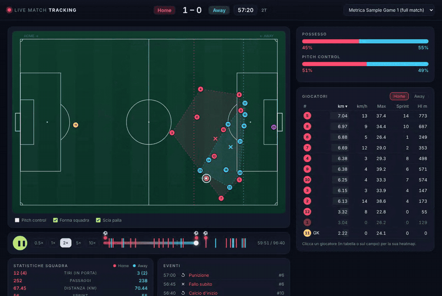
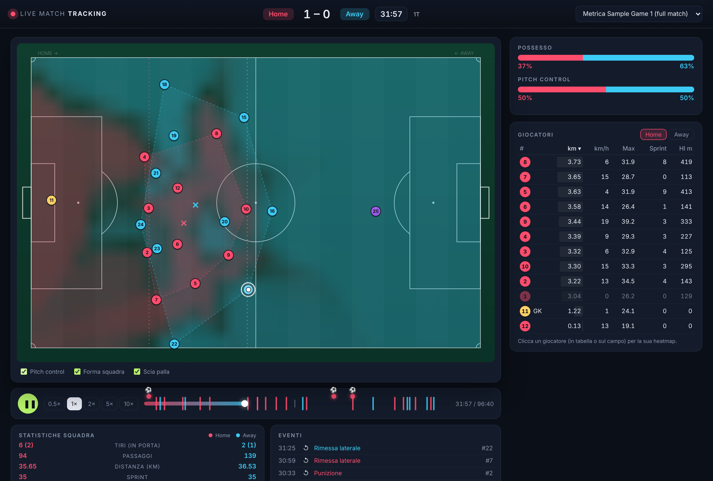
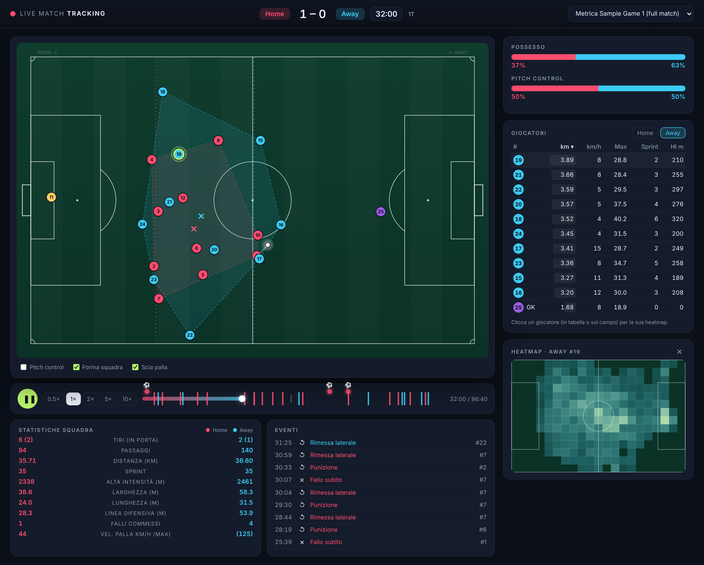
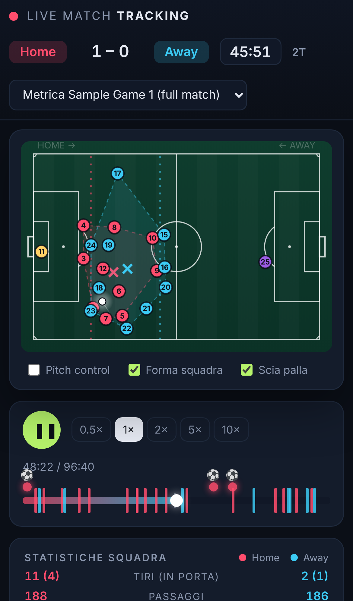
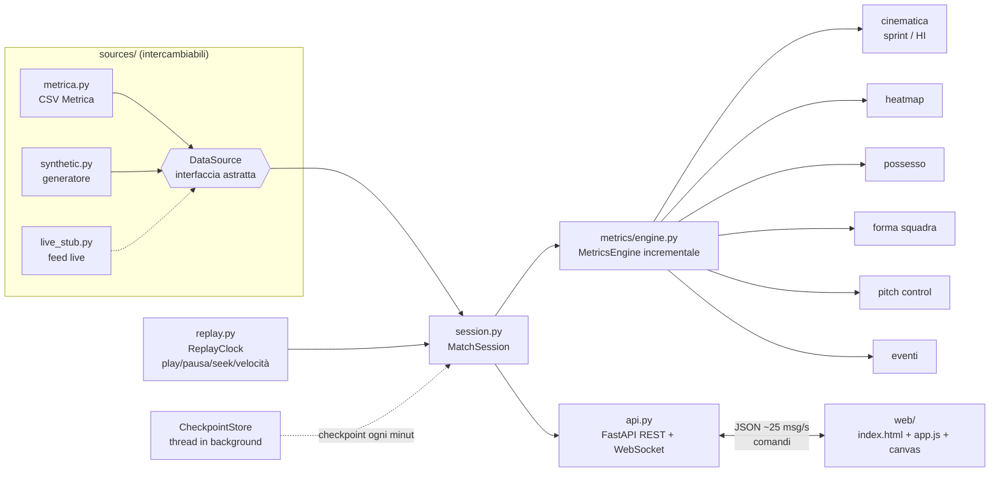

# Live Match Tracking

**Una partita di calcio vera, riprodotta come se fosse in diretta.**
I 22 giocatori (pallini con numero di maglia) e la palla si muovono su un campo visto dall'alto, mentre possesso,
distanze, velocità, sprint, forma di squadra, pitch control e heatmap si aggiornano in tempo reale.



| Pitch control | Heatmap del giocatore | Mobile (390 px) |
|---|---|---|
|  |  |  |

*Metrica Sample Game 1. In alto: 13 s di replay a 2× fino al gol del 2–0 (57:30). Media generata con `scripts/make_demo.js`.*

L'architettura è quella di un sistema live reale: la sorgente dati è un'interfaccia astratta (`DataSource`), e un feed
in diretta vero si collega scrivendo un solo adattatore, senza toccare replay, metriche, API o frontend.
Non è un progetto di computer vision: si lavora su **tracking data già pronti** (posizioni x, y di giocatori e palla a 25 Hz)
dei dati pubblici [Metrica Sports](https://github.com/metrica-sports/sample-data).

## Cosa fa

- **Replay "live"** a 0.5×, 1×, 2×, 5×, 10× con pausa, ripresa e seek su un punto qualsiasi della partita (click sulla timeline).
- **WebSocket a 25 messaggi/s** con posizioni compatte; il browser interpola tra gli snapshot a 60 fps.
- **Motore di statistiche incrementale**: ogni frame aggiorna lo stato delle metriche, nulla viene ricalcolato da zero.
- **Pannello live**: barre possesso e pitch control, KPI di squadra (tiri, passaggi, distanza, sprint, alta intensità,
  larghezza, lunghezza, linea difensiva, falli, velocità palla), tabella giocatori ordinabile, heatmap del giocatore
  selezionato (click sul pallino o sulla riga), feed eventi, banner al gol, timeline con tiri/gol/cartellini.
- **Overlay sul campo**: pitch control (rosso/azzurro), inviluppo convesso di ogni squadra con baricentro e linea difensiva,
  scia della palla, anello sul giocatore in possesso.
- 4 partite disponibili: Metrica Game 1 e Game 2 complete (se scaricate), un campione di 2 minuti incluso nel repo
  e una partita sintetica generata.

## Avvio rapido

Requisiti: Python ≥ 3.11 e `git`.

```bash
git clone https://github.com/Lupo433/live-match-tracking.git
```

```bash
cd live-match-tracking
```

```bash
python -m venv .venv && source .venv/bin/activate
```

```bash
pip install -e ".[dev]"
```

```bash
python scripts/download_data.py
```

```bash
python -m livematch
```

Poi apri **http://127.0.0.1:8000** nel browser (oppure con Docker: vedi [`docs/deploy.md`](docs/deploy.md)). Il download (≈230 MB) è facoltativo: senza, l'app funziona con il campione
di 2 minuti incluso (`data/sample/`) e con la partita sintetica. Opzioni: `python -m livematch --host 0.0.0.0 --port 8080`.
Una partita specifica si apre con `http://127.0.0.1:8000/?match=metrica_game_2`.

Comandi da tastiera: **spazio** = play/pausa. Click sulla timeline = seek. Click su un giocatore = heatmap.

### Test e lint

```bash
python -m pytest
```

```bash
ruff check . && ruff format --check .
```

I test (57) coprono loader e conversione coordinate, replay (timing, velocità, seek), ogni metrica con casi dal risultato
noto, sessione (nessun frame perso a 10×, seek coerente), API REST e WebSocket, adattatore live ed end-to-end sul campione.
La CI GitHub Actions (`.github/workflows/ci.yml`) esegue ruff e pytest a ogni push.

## Architettura



```
src/livematch/
├── schema.py            # modello dati unico: Player, Frame, Event, MatchInfo (metri, campo 105x68)
├── catalog.py           # partite disponibili, caricamento lazy con cache
├── replay.py            # ReplayClock: tempo reale -> frame (orologio iniettabile per i test)
├── session.py           # MatchSession (una per client) + CheckpointStore condiviso
├── api.py               # FastAPI: REST + WebSocket /ws
├── __main__.py          # python -m livematch
├── sources/
│   ├── base.py          # DataSource (ABC): info, players, events, frame(i), frames()
│   ├── array_source.py  # implementazione in memoria su array numpy
│   ├── metrica.py       # loader CSV Metrica -> schema interno
│   ├── synthetic.py     # partita sintetica plausibile (fallback e test)
│   └── live_stub.py     # adattatore per un feed live reale (da completare col provider)
├── metrics/
│   ├── engine.py        # compone tutte le metriche, snapshot JSON, checkpoint/restore
│   ├── kinematics.py    # distanza, velocità Savitzky-Golay, sprint, alta intensità
│   ├── heatmap.py  possession.py  shape.py  pitch_control.py  events.py
└── web/                 # una pagina statica: HTML + JS vanilla + canvas, nessun build step
```

**Flusso di un tick (ogni 40 ms, per client):** il `ReplayClock` dice a che frame siamo (`posizione = ancora + Δt·fps·velocità`);
la sessione passa al motore di metriche *tutti* i frame dall'ultimo consumato a quello corrente (a 10× sono 10 frame), con un
budget di tempo per non bloccare mai il WebSocket; poi invia un solo snapshot con le posizioni (e ogni 5 tick le statistiche).
Così ad alta velocità non si perdono frame nelle metriche e la banda resta costante.

**Seek istantaneo:** alla prima apertura di una partita un thread in background la processa per intero una volta
(~35 s per 90 minuti) e salva un checkpoint dello stato delle metriche ogni minuto, condiviso tra tutti i client.
Un seek riparte dal checkpoint più vicino e riprocessa al massimo un minuto di frame. Prima che i checkpoint siano pronti,
il badge "Sincronizzo statistiche…" mostra l'avanzamento del recupero.

### Protocollo WebSocket (`/ws?match_id=...&autoplay=1`)

Server → client:

| `type` | Contenuto |
|---|---|
| `init` | metadata partita, roster (`i, id, team, num, name, gk`), tutti gli eventi, partite disponibili, velocità ammesse |
| `frame` | `f` frame, `t` secondi, `per` periodo, `clk` orologio "57:29", `pl` posizioni `[x0,y0,x1,y1,…]` allineate al roster (`null` = fuori campo), `b` palla, `playing`, `speed`, `sync` (avanzamento metriche), `st` statistiche (~5 Hz) |
| `loading` / `error` | caricamento partita / comando non valido |

Client → server: `{"cmd":"play"}`, `{"cmd":"pause"}`, `{"cmd":"seek","frame":N}` (oppure `"minute":M` o `"fraction":0..1`),
`{"cmd":"set_speed","speed":5}`, `{"cmd":"select_match","match_id":"metrica_game_2"}`, `{"cmd":"select_player","player":i}`.

### Endpoint REST

| Endpoint | Descrizione |
|---|---|
| `GET /api/matches` | partite disponibili e partita di default |
| `GET /api/matches/{id}` | metadata e roster |
| `GET /api/matches/{id}/events` | eventi (coordinate in metri, casa sempre verso destra) |
| `GET /api/matches/{id}/summary` | statistiche finali dell'intera partita |
| `GET /api/health` | stato del servizio |

## Definizione delle metriche

Coordinate in metri, campo 105 × 68, origine in basso a sinistra; **la squadra di casa attacca sempre verso destra**
(il loader ruota di 180° i periodi in cui non è così; vedi [`docs/data_format.md`](docs/data_format.md)).

| Metrica | Definizione |
|---|---|
| **Distanza percorsa** | Somma dei passi tra frame consecutivi. Non contano: frame mancanti (NaN), cambio di periodo, salti > 15 m/s (glitch, rientri). Per squadra = somma dei giocatori. |
| **Velocità istantanea** | Derivata di un polinomio di grado 2 di Savitzky-Golay sugli ultimi 11 frame (0.44 s), valutata al centro della finestra (ritardo 0.2 s). Valori > 12.5 m/s scartati come glitch. |
| **Velocità massima** | Massimo della velocità istantanea filtrata. |
| **Sprint** | Sforzo con velocità > 7 m/s mantenuta per almeno 1 s. Conteggio e metri (dall'inizio dello sforzo). |
| **Alta intensità (HI)** | Come lo sprint ma con soglia 5.5 m/s. Conteggio e metri. |
| **Heatmap** | Secondi trascorsi da ogni giocatore in ciascuna cella di una griglia 21 × 14 (5 × 4.9 m), aggiornata a ogni frame. |
| **Possesso** | A ogni frame con palla tracciata, la squadra del giocatore più vicino alla palla entro 3 m; se nessuno è entro 3 m il possesso resta all'ultima squadra. Percentuale cumulata sui frame con palla in gioco. |
| **Baricentro** | Media delle posizioni dei 10 giocatori di movimento (portiere escluso). |
| **Larghezza / lunghezza** | Estensione in y / in x dei giocatori di movimento. Nel pannello: valore attuale (media mobile esponenziale), campionato a 5 Hz a palla in gioco. |
| **Linea difensiva** | Distanza dalla propria porta della media dei 4 giocatori di movimento più arretrati. |
| **Pitch control** | Modello a tempo di intercetto (semplificazione di Spearman 2017): per ogni cella di una griglia 32 × 21, tempo di arrivo = 0.7 s di reazione + distanza dalla posizione proiettata (posizione + velocità × 0.7 s) / 5 m/s; probabilità di controllo di casa = logistica della differenza tra il miglior tempo ospite e il miglior tempo casa (σ = 0.45 s). Percentuale = media della griglia, cumulata una volta al secondo di gioco a palla in gioco. |
| **Velocità palla** | Savitzky-Golay (finestra 5, grado 1) sulla posizione della palla, max 45 m/s. |
| **Eventi** | Gol (`SHOT` con sottotipo `…GOAL`), tiri e tiri in porta, passaggi, falli commessi (da `FAULT RECEIVED` dell'avversario), cartellini, calci d'angolo: contati quando il replay supera il frame dell'evento. |

## Come collegare un feed live reale

Tutto il sistema dipende solo da `DataSource` (`sources/base.py`): `info`, `players`, `events`, `frame(i)`.
Lo scheletro `sources/live_stub.py` (`LiveFeedSource`) implementa già un buffer thread-safe che cresce frame dopo frame
ed è compatibile con il motore di metriche (c'è un test che lo alimenta e confronta i risultati con la sorgente originale).
Per collegare un provider:

1. **`connect()`**: apri la connessione (WebSocket/TCP/HTTP streaming) leggendo le credenziali da variabili d'ambiente,
   e in un task/thread di lettura chiama `ingest(messaggio)` per ogni pacchetto.
2. **`parse_message()`**: traduci il formato del provider nello schema interno: mappa gli id giocatore sul roster costruito
   dalle formazioni (indici stabili per tutta la partita), converti le coordinate in metri (105 × 68, origine in basso a
   sinistra), normalizza il verso d'attacco a inizio di ogni periodo (casa verso x = 105), NaN per dati mancanti,
   `frame_id` contigui da 0.
3. **Jitter buffer**: riordina i pacchetti in ritardo o fuori ordine prima di `push_frame`.
4. **Registra la sorgente nel catalogo** (`catalog.py`) con un `MatchEntry`.
5. **"Live edge"**: per una partita in corso il client deve seguire l'ultimo frame disponibile a 1×; basta aggiornare
   `ReplayClock.n_frames` con `len(source)` a ogni tick (o scrivere un piccolo `LiveClock`). Il seek all'indietro (DVR)
   funziona già grazie all'accesso casuale e ai checkpoint.

Metriche, API e frontend restano invariati.

## Limiti noti

- **Possesso approssimato**: basato sulla sola prossimità alla palla; non distingue un contrasto da un controllo.
- **Pitch control semplificato**: niente probabilità di controllo dipendente dal tempo di volo della palla né parametri
  per giocatore; serve come indicatore visivo e di dominio territoriale.
- **Dati Metrica**: squadre anonime ("Home"/"Away"), palla non tracciata nel ~40% dei frame (palla non in gioco).
  I gol nel CSV sono marcati al frame del tiro: il sistema cerca il passaggio della linea di porta nei 5 s successivi
  (8 gol su 8 rilevati); se la palla non è tracciata, banner e punteggio restano al frame del tiro.
- **Ritardo delle velocità**: la velocità filtrata si riferisce a 0.2 s prima del frame mostrato.
- **Prima apertura in assoluto di una partita completa**: ~10 s di conversione dei CSV e ~35 s di pre-calcolo in background
  dei checkpoint (il replay parte subito; solo i seek lontani mostrano per qualche secondo "Sincronizzo statistiche…").
  Entrambi vengono salvati in `.cache/`: dalla seconda volta l'apertura richiede ~1 s.
- **Una sessione di replay per connessione**: ogni spettatore ha il proprio replay; nessuna sincronizzazione tra spettatori.
- Lo stub live non include un client per un provider specifico.

## Documentazione

- [`docs/data_format.md`](docs/data_format.md) — formato dei dati Metrica, verificato sui file reali.
- [`DECISIONS.md`](DECISIONS.md) — scelte progettuali e motivazioni.
- [`PROGRESS.md`](PROGRESS.md) — stato del lavoro e prossimi passi.
- [`ROADMAP.md`](ROADMAP.md) — idee future (tracking da video, xT, xG, marketing analytics).

## Licenza dei dati

I dati di esempio sono pubblicati da Metrica Sports nel repository
[metrica-sports/sample-data](https://github.com/metrica-sports/sample-data) per uso da parte della comunità;
nel repo è incluso solo un campione di 2 minuti in `data/sample/`.
